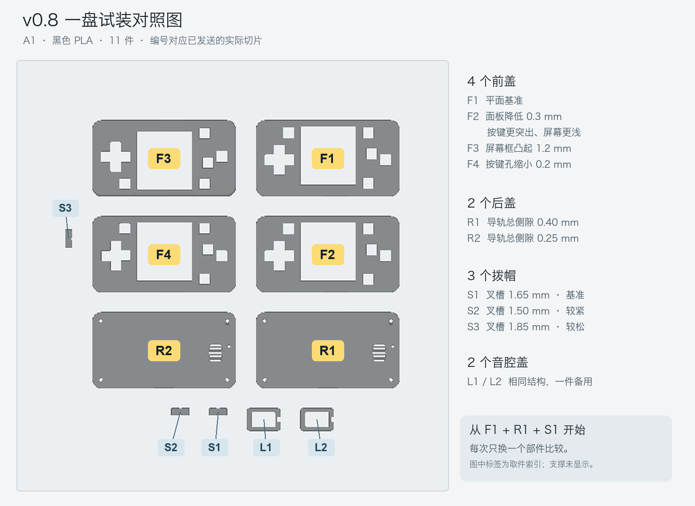

# v0.8 一盘验证件

本盘共11件：F1–F4前盖各1件，R1/R2后盖各1件，S1–S3拨帽各1件，开窗音腔盖2件（相同，备用）。全部黑色PLA，A1 0.4 mm喷嘴、0.16 mm层高、4层墙、20% gyroid填充。切片预计54.14 g、约3小时46分钟，实际以机器进度为准。

前盖编号凹刻在屏幕正下方，后盖编号凹刻在电池框内，刻深0.32 mm。拨帽内侧横边底部有1/2/3个小凹点，对应S1/S2/S3。两件音腔盖完全相同。

## 前盖配置

所有前盖共用PCB位置，按约1 mm胶＋1.9 mm玻璃计算；全部去掉玻璃上方压边。A键在源PCB模型里稍有旋转，孔比其他按键多留0.2 mm。数字为名义设计值，打印和胶层会有误差。

| 编号 | 主要变化 | 按键露出 | 玻璃低于屏幕框 | 普通按键孔 / A键孔 |
| --- | --- | ---: | ---: | --- |
| F1 | 标准平面，比较基准 | 1.4 mm | 0.7 mm | 6.6 / 6.8 mm |
| F2 | 平面外表面降低0.3 mm，螺丝/PCB定位保持原位 | 1.7 mm | 0.4 mm | 6.6 / 6.8 mm |
| F3 | 屏幕框比按键区高1.2 mm（原A方案） | 1.4 mm | 1.9 mm | 6.6 / 6.8 mm |
| F4 | F1基础上按键孔缩小0.2 mm | 1.4 mm | 0.7 mm | 6.4 / 6.6 mm |

F2用于判断更浅屏幕、更明显按键是否合适；F3用于比较护框手感；F4用于找更紧凑的按钮孔边缘。不要一开始同时换前盖、后盖和拨帽，否则难以确定改善来自哪里。

## 后盖与拨帽配置

两件后盖的电池框、喇叭围壁、0.9 mm矮脚、出声浅槽和外形相同，只比较拨帽导轨松紧。电池框净空52×30 mm，成品电池建议≤51×29×3.3 mm，电池仍未选型。

| 编号 | 变化 | 标识 |
| --- | --- | --- |
| R1 | 标准导轨宽1.70 mm；配1.30 mm内横边，名义总侧隙0.40 mm | 电池框内R1 |
| R2 | 导轨宽1.55 mm；名义总侧隙0.25 mm，连接颈部通道同步让位 | 电池框内R2 |
| S1 | 拨杆叉槽1.65 mm，基准 | 横边底部1个凹点 |
| S2 | 叉槽1.50 mm，较紧 | 横边底部2个凹点 |
| S3 | 叉槽1.85 mm，较松 | 横边底部3个凹点 |

三种拨帽内侧横边均为10.4 mm，导轨机械行程3.6 mm；实际开关的电气两档需装机确认。安装时轻拨后盖两处防脱弹片，放入拨帽再释放，不要硬压或剪断弹片。

## 推荐试装顺序

1. 取件后去除支撑和brim，尤其检查拨帽叉槽、导轨、螺丝柱、TF口、音腔及弹片周围。F3采用正面朝上的摆放以保留凸框外观，其支撑主要在内面；其他前盖正面朝下。检查时先排除支撑残留造成的假干涉。
2. 固定使用R1＋S1，依次装F1、F2、F3、F4。先无螺丝轻合检查：盖缝、按钮回弹、玻璃周边让空、TF/Type-C可插入。出现卡住时先退出，定位接触处。
3. 先选1–2个前盖做完整螺丝试装。每个需要4颗原规格M2×2×3热熔螺母，配M2×5螺丝；若螺母数量不足，先无螺丝筛选。不要用螺丝强行拉合外壳。
4. 黑背景下逐步拧紧，按MENU/A/B及屏幕附近壳面，记录是否泛白/出现水波纹；分别记录按键是否足够突出、是否擦孔边。F4若摩擦或回弹差，优先F1孔径。
5. 选定前盖后固定R1，分别试S1、S2、S3，比较拨杆是否卡、操作前空行程、两档是否能可靠切换。再用表现最好的一只拨帽比较R1/R2，避免把叉槽松与导轨晃混为一谈。
6. 音腔用同一音源和音量，比较开窗盖/无盖，手持/桌面平放。两件盖相同，可给两个后盖各装一个。拆盖前先取PCB；轻拨前卡扣、抬起前边、退出后挂钩。

## 前盖记录（固定R1＋S1）

| 项目 | F1 | F2 | F3 | F4 |
| --- | --- | --- | --- | --- |
| 无螺丝合盖是否贴合 | | | | |
| 拧紧后是否有盖缝 | | | | |
| 黑屏是否泛白 | | | | |
| MENU/A/B是否导致水波纹 | | | | |
| 按键手感/露出是否合适 | | | | |
| 是否擦孔边或回弹慢 | | | | |
| 屏幕深浅/护框舒适度 | | | | |
| TF/Type-C插拔 | | | | |

## 拨帽记录（固定选中的前盖）

| 组合 | 装入难度 | 横向/上下晃动 | 操作前空行程 | 两档可靠切换 | 是否会脱落 |
| --- | --- | --- | --- | --- | --- |
| R1+S1 | | | | | |
| R1+S2 | | | | | |
| R1+S3 | | | | | |
| R2+选定S | | | | | |

最终想保留的组合：F___ + R___ + S___。若最佳的是F2高度＋F4孔径等跨方案组合，反馈这两个特征即可，下一版可以合并。

声学记录：开窗盖/无盖哪个更响____；平放桌面衰减是否改善____；有无异响____。

## 文件与验证

- 可编辑FreeCAD：myMicrobyte_v08_trials.FCStd；每个编号对应一个独立实体。
- 原始参数：configurations.json；打印姿态网格：各编号_print.stl。
- 拓竹工程：../../printing/A1_black_PLA_v08_trials/myMicrobyte_v08_trials_black.3mf。
- 最终切片：../../printing/A1_black_PLA_v08_trials/myMicrobyte_v08_trials_black.gcode.3mf。
- 校验：../../reports/v08_trials/trial_geometry_validation.json、print_project_validation.json。

几何检查覆盖4×2前后盖组合、LCD包络、源PCB与开关模型，以及三只拨帽在两个后盖中的行程。11件STL均封闭、单实体、无自交。切片逐件确认同一黑色PLA、同盘不越界，并检查了凹刻ID、弹片和音腔的实际路径。弹性、压力、声学与打印公差仍以这轮实物结果为准。

## 排版与打印状态

已发送至A1，使用A4黑色PLA。2026-10-17 21:50前后观察到机器进入第1/109层、进度3%；机器当时预计10月18日01:27完成。此为发送后的状态记录，不代表打印完成。
