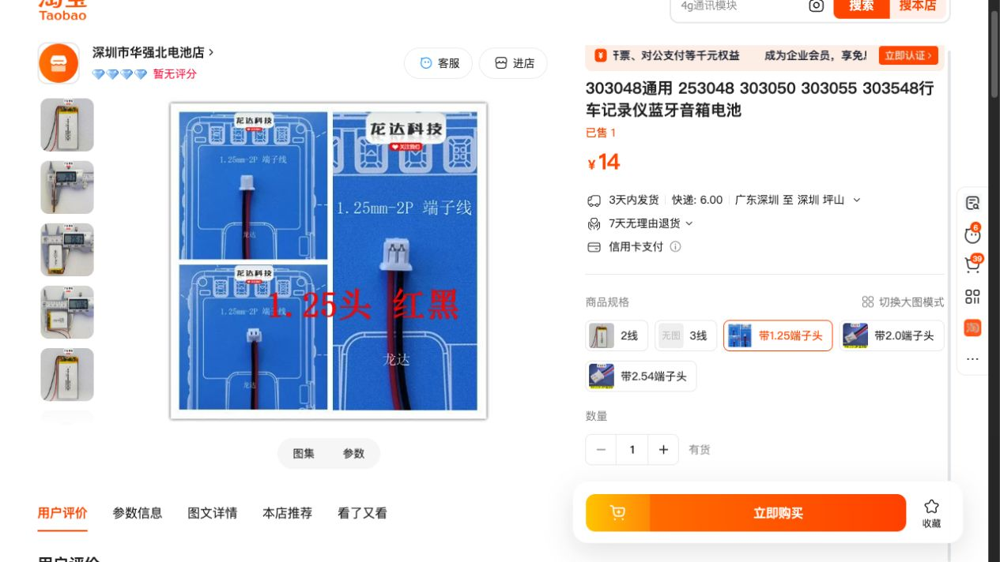
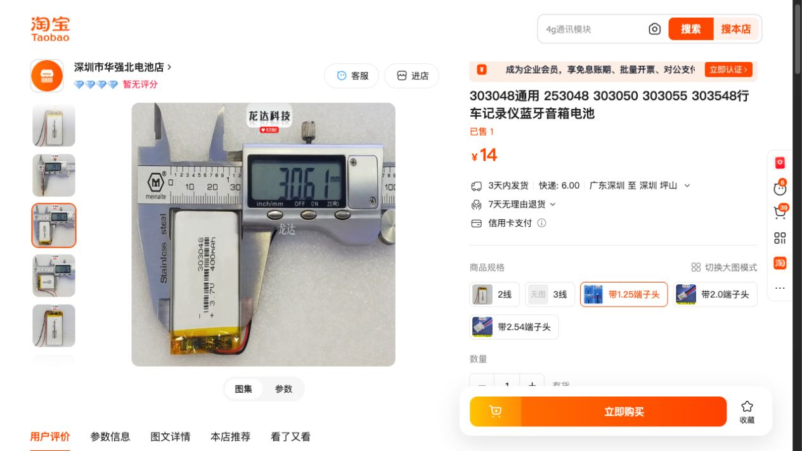
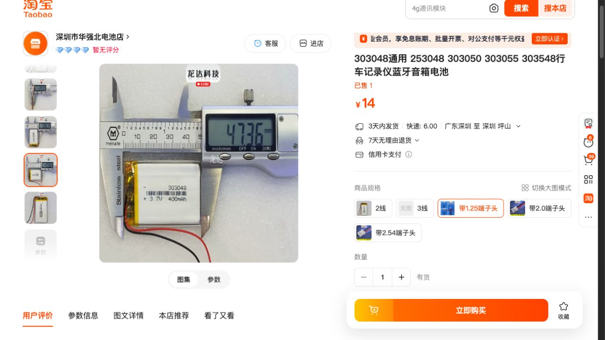
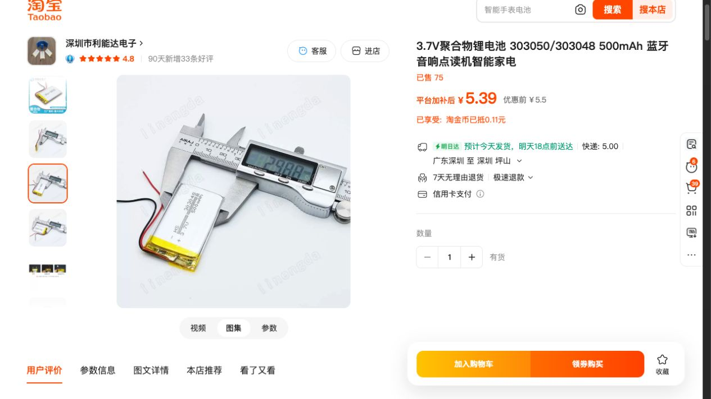
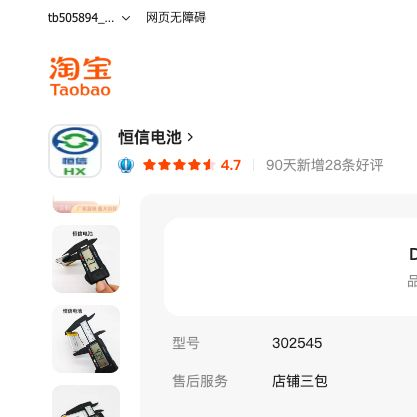

# 电池扩容与插头选购（2026-10-20）

## 结论

当前 v0.10 后盖电池框内尺寸 52 × 30 mm，建议成品电池不超过 51 × 29 × 3.3 mm。

已完成独立 FreeCAD 扩容可行性模型：电池框内尺寸改为 57 × 32 mm，电池最大建议成品包络 56 × 31 × 3.3 mm（长×宽×厚），电池底面 Z=1.7 mm。长宽面积比原建议包络增加约 17.4%。建议购买标称 3 mm 厚的电池，成品尺寸包括保护板、胶带、包边与侧面出线凸起。

该扩容模型不是当前已发送打印的四套 v0.10；未改动打印任务或原版生产文件。

## 几何校核

来源：output/v10/myMicrobyte_enclosure_v10.FCStd，以及该文件中的 PCB 实体、连接器保守包络及硬件参考。

- 扩容后后盖有效，单一实体。
- 56 × 31 × 3.3 mm 电池包络与后盖实体交叠体积为 0；与参考元件无相交。
- 新电池框与参考元件无相交。
- 关键保守间隙：Type-C 下方 0.400 mm、喇叭插座 0.433 mm、ESP32 屏蔽罩下方 0.680 mm。
- 增加到 56 × 32 × 3.3 mm 时，按检查位置与喇叭插座包络发生相交，不推荐。
- 增厚到 3.5 mm 虽无静态相交，但 Type-C 下方仅余 0.2 mm，不推荐。
- 57 mm 长度虽能在模型中放下，但没有足够的框内端部装配余量，所以采购上限保留为 56 mm。
- 电池框内四周约 0.5 mm 余量；仍需实物验证打印公差、包边、线材走向和长期使用变化。此处没有声称无限制几何最大值。

商品照片中的 47.36 × 30.61 × 2.97 mm 电池也已做包络检查，无相交；与喇叭插座保守间隙 0.623 mm，与 Type-C 下方间隙 0.730 mm。

## PCB 白色连接器

实际 PCB 文件中，BAT 和 SPEAKER 均为 **HC-1.25-2PWT**，2 针、1.25 mm 间距的卧式贴片板端座。

采购要的是与它配套的 **1.25 mm 2P 线端插头/端子线**。不要购买另一只板端座；也不能只凭“JST 1.25”或间距相同认定外形锁扣兼容。

BAT：1 脚为 GND（负极/黑线），2 脚为电池正极（红线，连接 TP4057 BAT）。左右顺序必须以插头朝向、板端 pin 1 定义为准，不应凭卖家的“正向/反向”文字或喇叭线颜色推定。

## 淘宝候选

均为页面标称容量，未经容量实测。价格为本次页面显示，运费按页面地址估算；四只价格假设同店合单只收一次所示运费，需以结算为准。未联系卖家或下单。

| 商品与链接 | 尺寸、标称容量 | 插头情况 | 单价与四只估算 | 适配判断 |
|---|---|---|---|---|
| [深圳市华强北电池店 303048](https://item.taobao.com/item.htm?id=583403331970) | 400 mAh；描述 48×30×3 mm；卡尺图约 47.36×30.61×2.97 mm | 已选“带1.25端子头”，图示 1.25 mm-2P；需确认 HC 插座配合和线序 | ¥14/只，运费 ¥6；四只约 **¥62** | 新扩容框候选；原框不推荐，实测宽度超过 30 mm |
| [利能达 303048/303050](https://item.taobao.com/item.htm?id=599467352261) | 500 mAh；详情型号303048，卡尺图约49.71×29.87×2.99 mm | 页面所见为裸引线，未确认可配 HC 1.25-2P | 常规¥5.50/只、页面优惠¥5.39，运费¥5；四只按原价约 **¥27，另计加插头费用** | 扩容框尺寸候选；容量和价格更好，但目前不满足已确认带插头条件 |
| [恒信 302545](https://item.taobao.com/item.htm?id=611922672957) | 320 mAh；标称45×25×3 mm | 详情明确可订做1.25端子头，需确认HC配套/费用/线序 | ¥3.50/只，运费¥6；四只约 **¥20，另计定制插头费用** | 当前后盖也有充足尺寸余量；容量较小 |

### 带插头 400 mAh 款

### 500 mAh 待确认插头款

### 恒信小尺寸定制插头款

## 建议

- 优先考察利能达 500 mAh：若卖家可按下方要求装 HC 配套插头，且确认成品尺寸和充放电参数，容量/价格更值得考虑。当前不能把它列为已确认即插即用商品。
- 现货有“带1.25端子头”选项的是华强北 400 mAh 款；仍需核对配合结构和极性，不能仅凭 1.25 的名字保证通用。
- 如果要直接装当前正在打印的后盖，优先小于等于 51×29×3.3 mm 的成品电池，例如恒信 302545 定制配套端子。

可复制给商家的询问（未发送）：

> 要4只3.7V单节锂聚合物电池，带保护板，标称厚度3mm。成品包含保护板、胶带包边、出线凸起后，不超过56×31×3.3mm。请提供成品实测长宽厚。插头需配合HC-1.25-2PWT卧式板端座，2针、间距1.25mm，请提供插头正面/侧面照片核对。板端1脚接电池负极黑线，2脚接正极红线。请报价4只含配插头和运费，并提供电芯最大允许充电电流和连续放电电流。

PCB 中充电芯片为 TP4057，PROG 上的 R13 标注2kΩ。最终电芯选型还需按具体芯片数据手册或实测充电电流核对；“保护板允许2A”不能代替电芯允许充电电流。此前320mAh商品写最大1C（320mA），500mAh商品写最大1C（500mA），400mAh商品未找到明确电芯充电上限。

## 文件

- `enlarged_frame_study.FCStd`：独立扩容可行性模型。
- `space_check.json`：检查结果。
- `check_space.py`：可复现检查脚本。参考间隙采用保守包围盒，发生包围盒重合时再做实体布尔相交。
